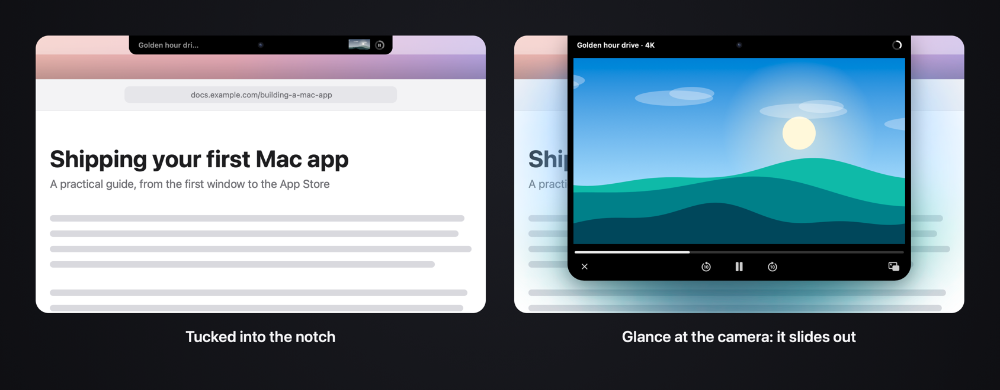

# CineNotch

**Glance at your camera and the video slides out of the notch. Look back at your work and it
tucks away.**

CineNotch docks the Picture in Picture video from Safari or Chrome into the notch (or a drawn
pill in the menu bar on Macs without one) instead of letting it float over your work. You don't reach for the
mouse to watch it: a glance is enough.

CineNotch is open source under the GPLv3. It is free to download for now and becomes a $14.99
one-time purchase soon (see [Pricing](#pricing)), and you can always build it yourself: see
[Build from source](#build-from-source).



## Open it with a glance

- **Glance at the camera.** The island leans out and the mascot's eyes open while the glance
  builds up, then the video slides out at full size.
- **Keep watching.** It stays open while your eyes are on the video.
- **Look back at your work.** It tucks back into the notch, and the audio keeps playing.

A 50-second calibration learns your eyes, and your clicks keep it tuned to how you sit, so it
gets steadier after a minute of normal use. Frames are analyzed on your Mac, never stored or
sent anywhere, and the camera is on only while a video is docked.

Prefer the mouse? Hover the island to open it, move the cursor away to close it.

## Also

- **Collapsed:** a black pill with a live thumbnail, the video title and a progress ring.
- **Open:** the video at full size with play/pause, ±10 s, back-to-the-browser and close
  buttons (no close for Chrome's video). Scroll over it (two fingers, or the mouse wheel) to move
  it in 10 s steps.
- **Video size**: small, medium (the default) or large, in Settings → General and the menu. A
  pinch over the open video, or ⌃⌥⌘= and ⌃⌥⌘−, makes it one size bigger or smaller. The PiP
  window is resized with it, so the picture stays sharp.
- **Keyboard shortcuts** from any app (Settings → Keyboard turns them off): ⌃⌥⌘P play or
  pause, ⌃⌥⌘[ and ⌃⌥⌘] back or forward 10 s, ⌃⌥⌘O open the island and keep it open, or close
  it, ⌃⌥⌘= and ⌃⌥⌘− a bigger or smaller video.
- **Pause When the Island Closes** (off by default, in the menu and Settings → General): the
  video plays only while the island is open. It pauses when the island tucks in and plays again
  when it opens; a video you paused yourself stays paused.
- **Pause When You Step Away** (on by default, in the menu and Settings → General): with the
  glance on, nobody in front of the camera for 3 seconds pauses the video, and it plays again
  when you're back. A video you paused yourself stays paused.
- **Hide When Someone's Behind You** (on by default, in the menu and Settings → General): with
  the glance on, a second face near the camera tucks the island into the notch and pauses the
  video. When it's just you again, the island comes back and the video plays once you open it.
  Someone who stays for a minute is probably watching along, so the island comes back and stays
  until they've left.
- The island grows out of the notch when Picture in Picture starts and tucks back into it when
  it ends; a soft glow in the video's colors sits under the open island (Settings → General).

Status: early. Safari and Chrome, one screen.

## Download

**[Download CineNotch](https://github.com/NikOneZ1/cinenotch/releases/latest/download/CineNotch.dmg)**
for macOS 14 or later, Apple silicon and Intel. It's also on [cinenotch.cam](https://cinenotch.cam).
CineNotch is free to download for now and becomes a $14.99 one-time purchase soon.
The app is signed with Developer ID and notarized by Apple: open the disk image and drag
CineNotch to Applications.
<!-- FLIP (when it is for sale): replace the Download text above with something like this, and fix the
anchor of the Pricing section below.

**[Buy CineNotch at cinenotch.cam](https://cinenotch.cam/#pricing)**: a one-time purchase of
$14.99, with no subscription. One license covers up to 3 of your Macs and every 1.x update, and
there's a 30-day money-back guarantee instead of a free trial. Payments go through
[Creem](https://creem.io), which emails you a license key.
License key entry isn't built yet: once it ships, say here where the key goes.
-->
From 0.2.0 on it updates itself with [Sparkle](https://sparkle-project.org): once a day it checks
`cinenotch.cam/appcast.xml` (Settings → General turns that off), and **Check for Updates…** is
in the menu.

## First launch

A short onboarding asks for two permissions:

- **Accessibility**: to find the PiP window, tuck it away and press its buttons.
- **Screen Recording**: to show the PiP video in the island. Only the PiP window is captured,
  and nothing leaves the Mac. macOS applies this permission after the app restarts.

Its last step also asks whether CineNotch should open at login (Settings → General → **Open
at login**). Then start Picture in Picture on any video in Safari or Chrome.

### The glance

The glance is on from the start, but it needs a calibration before it can work: until then the
camera stays off. The first time a video docks, a card under the island offers the calibration
(**Calibrate**, **Later** to be asked on the next launch, or **I'll use the mouse** to turn the
glance off). macOS asks for camera access, then you follow the targets for about 50 s. It's
also in the menu (**Calibrate…**) and in Settings → Gaze, where **Recalibrate…** lives too.
**Sensitivity** trades accidental reveals (strict) against glances that need repeating
(sensitive). Settings → Gaze shows what the camera sees and where it thinks you look.

The camera runs only while a PiP video is docked and the glance is on, so the green camera
light is on during that time.

## Build from source

The code is open, so you can build the app yourself, for free. It needs macOS 14 or later and
Swift 5.9+ (Xcode or just the Command Line Tools).

```bash
./scripts/make-dev-cert.sh   # once: local signing identity, keeps permissions across rebuilds
./scripts/run.sh             # build build/CineNotch.app and (re)start it
```

`./scripts/release.sh` builds the download: a universal app signed with Developer ID, notarized
and stapled, in a notarized `build/CineNotch.dmg`. It needs the Developer ID certificate and
notarytool credentials (see the comment at the top of the script).

## How it works

Safari's PiP window belongs to the system process `PIPAgent`. CineNotch:

1. Finds it through the Accessibility API, resizes it to the island's video size, and parks
   it in the bottom-right corner of the screen so that only its transparent, rounded top-left
   pixel stays on screen. PIPAgent refuses positions that are fully off screen, and a hidden
   window can't be captured, so the window has to stay technically visible.
2. Streams that window with ScreenCaptureKit into the island. The stream stays open all the
   time (starting one takes about 250 ms): 10 fps for the thumbnail, 60 fps while expanded.
3. Reads the progress (`AXValueDescription` of the scrubber, e.g. "33%") and play state from
   the PiP window's accessibility tree, and presses its buttons for the controls.
4. Takes the title from the active Safari tab at the moment PiP starts.

On quit (including `SIGTERM`), the PiP window is put back where it was. If CineNotch
crashes, the PiP window stays in the corner; relaunch CineNotch or close PiP from Safari.

### Chrome

Chrome draws its own PiP window: a floating window of the browser process. CineNotch finds it
through the Accessibility API too (Chrome turns its accessibility tree on when asked, as it does
for screen readers), parks and streams it the same way, and takes the title from the tab Chrome
marks as "Video playing in picture-in-picture mode", so it follows the next video in that tab.
Chrome keeps its window inside the screen while resizing, so the window is resized at the top
left before it's parked. Unlike the system window, it stays on the desktop (Space) it was opened
on; CineNotch keeps it docked when you switch desktops.

Chrome's own buttons exist only under the real cursor, so the controls go through macOS's Now
Playing instead, where Chrome publishes the video: play state, position, play/pause and seeking.
Since macOS 15.4, Now Playing (the private MediaRemote framework) only answers Apple's own
processes. CineNotch does what other Mac media apps do
([mediaremote-adapter](https://github.com/ungive/mediaremote-adapter)): it loads a small library,
`Sources/NowPlayingBridge`, into `/usr/bin/perl`, which macOS still answers, and talks to it over
stdin/stdout while a Chrome video is docked. The controls show only while Now Playing is about
the docked video (same title), since another tab may be playing music.

### Gaze

Vision finds the face and eye landmarks in the camera feed (15 fps; full face detection every
5th frame, the face box follows the landmarks in between). Each eye is cut out along the line
between the eyes, scaled to 20×10 and brightness-normalized; with 13 head-pose numbers (where
the nose, mouth, chin and brows sit relative to the eyes, Vision's pitch/yaw, head position)
that makes the frame's feature vector. A per-user ridge regression maps it to a point on the
screen; the regularization (with a lighter penalty for the head-pose part) is picked by
cross-validation over calibration steps.

Calibration (~50 s) walks the eyes over the screen, into the camera lens, across the video,
and over traps right under the pill, partly while moving the head, so the model learns that
head movement alone doesn't move the gaze.

Live, frames where the landmarks glitch or the eyes blink are dropped, predictions go through a
median of three and a One Euro filter, and decisions are votes: 70% of the last 0.35 s in the
camera zone reveals (85% of 0.6 s while you type, click or scroll), 75% of the last 0.8 s
elsewhere collapses; the pill glows while a glance builds up. People look at what they click,
so every click tells where the user really looked: the median gap between clicks and
predictions over the last ten clicks corrects posture drift. How far the camera zone reaches
down is the **Sensitivity** setting (strict, balanced, sensitive).

**Test Gaze Engines…** (menu bar icon with ⌥ held, like the other developer items) records a ~40-second follow-the-dot session (with two clicks, camera →
video → elsewhere sequences and the usual traps) and scores the engine on it: zone accuracy,
reveals and their latency, collapses, false reveals, whether the video stays open while you
watch it. Recordings stay in `~/Library/Application Support/CineNotch/gaze-tests/`;
`--evaluate-gaze` re-scores on all of them. Engines live in `Sources/CineNotch/Gaze/Engines`: a
new idea goes in as another engine next to the current one and is compared on the same frames.

### What we tried

The current engine is v8. On recorded tests (8 sessions, 24 camera glances) it made 5
user-visible mistakes in strict mode, against 11–23 for the earlier versions:

- **Pupil points from Vision** (v0) barely move when only the eyes move; eye pixels do.
- **A camera boundary derived from calibration** (v1–v4) kept landing wrong: halfway to the
  video it sat right on the browser tabs under the pill (every false reveal happened there);
  between camera and those traps, it relied on held-out estimates that are skewed with only a
  few camera steps. Hence the sensitivity setting.
- **A dedicated camera classifier** (v3) told "elsewhere" apart best but missed glances for the
  same skewed-threshold reason.
- **A pretrained gaze network** ([yakhyo/gaze-estimation](https://github.com/yakhyo/gaze-estimation),
  L2CS-style, v5–v7) gave steadier raw angles but separated the video from the rest of the
  screen worse, cost a quarter of a CPU core more, and is trained on data licensed for
  non-commercial use only.
- **Posture drift** was the biggest problem of all: within 15 minutes of calibrating, every
  engine without drift correction had its whole picture shifted by 0.1–0.7 screen heights and
  stopped working. Correcting from clicks fixed that for every model; with it, the eye-pixel
  model came out ahead.

## Developer flags

Hold ⌥ while opening the menu bar icon for the developer items: the gaze debug panel, the gaze
engine test, and the logs folder.

```bash
./scripts/run.sh --debug-fake-pip                 # a drawn video instead of Safari's, no PiP needed
./scripts/run.sh --debug-slow-motion              # island animations at a fifth of their speed
./scripts/run.sh --debug-notch                    # notch layout on a Mac without a notch
./scripts/run.sh --debug-cycle                    # expand/collapse every 3 s, no mouse needed
./scripts/run.sh --debug-snapshots /tmp/cinenotch  # save screenshots around every state change
./scripts/run.sh --debug-island-png /tmp/island   # pictures of the island window alone (timed frames with slow motion)
./scripts/run.sh --debug-windows /tmp/windows     # pictures of each onboarding step and Settings tab
./scripts/run.sh --debug-overlay /tmp/overlay     # pictures of the calibration screens
./scripts/run.sh --debug-gaze                     # open the gaze debug panel on launch
./scripts/run.sh --evaluate-gaze                  # score gaze engines on all recorded tests, then quit
```

The app icon is drawn by `swift scripts/make-icon.swift`, which writes `Resources/AppIcon.icns`.

Logs: `~/Library/Logs/CineNotch.log`. While the gaze debug panel is open, every analyzed frame
goes to `~/Library/Logs/CineNotch-gaze.csv`. Calibration samples are kept in
`~/Library/Application Support/CineNotch/gaze-calibration.json`.

## Known limitations

- The title is the active Safari tab's title when PiP starts. It doesn't update when the
  next video autoplays, and is wrong if PiP was started from a background tab.
- Chrome's video can't be closed from the island: back-to-the-browser only shows its tab.
- If CineNotch starts while Chrome's PiP window is on another desktop, it picks the window up
  only once you switch to that desktop.
- Chrome's play/pause, ±10 s and progress rely on the Now Playing workaround above. If a macOS
  update closes it, they disappear and the video stays in the island without them. They also
  hide while Now Playing names another video than the tab (for example, music in another tab).
- Progress has 1% resolution (that's all PiP exposes) and there is no time readout.
- DRM-protected video (Netflix, Apple TV+) is captured as black.
- On Macs without a notch the 300 pt pill can cover menu bar items near the center.
- Gaze reveal costs about a third of a CPU core while the camera runs (Vision at 15 fps). Click
  correction follows posture changes, but a very different setup (another chair, an external
  monitor) still calls for recalibrating.

## Roadmap

- External displays
- Other browsers: Arc, Edge, Brave and Firefox draw their own PiP windows too (the Chromium
  ones probably work like Chrome)

## Pricing

CineNotch is free to download for now. It becomes a $14.99 one-time purchase soon, for the signed,
notarized app that updates itself. The source code stays open under the GPLv3, and you can always
build it yourself.
<!-- FLIP (when it is for sale): add a short "Why is it paid?" section here, along these lines.

CineNotch is a one-person project. The code is open and stays open, but shipping it takes work:
signing and notarizing every release (which needs an Apple Developer membership), fixing
things when a macOS update changes how Picture in Picture behaves, and answering mail. The
paid, signed build with its updates and support is what pays for that. Prefer to do it yourself?
Build it from source: that's what the GPLv3 is for.
-->

## License

CineNotch is free software under the [GNU General Public License v3.0](LICENSE).
Copyright © 2026 Nikita Verba. You can read, build, change and share it under that license, and
that stays true when the app becomes a paid purchase: what will be sold is the signed, notarized
build, not the code.

The license doesn't cover the CineNotch name and app icon: if you publish a fork, please give it
its own name and icon.
